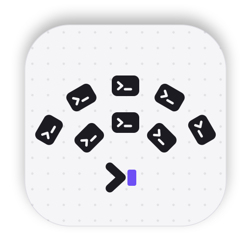

<p align="center">
  
</p>

<h1 align="center">Bashestra</h1>

<p align="center">
  <b>Conduct your orchestra of coding agents.</b><br>
  An app for macOS and Linux that runs Claude Code, Codex, Gemini CLI and OpenCode side by side on an infinite canvas.<br>
  Every node is a real terminal. Draw a line between two agents and they can message each other.
</p>

<p align="center">
  <a href="https://github.com/federix-ai/draftboard-app/releases/latest/download/Bashestra.dmg"><b>⬇ Download for macOS</b></a>
  &nbsp;·&nbsp;
  <a href="https://github.com/federix-ai/draftboard-app/releases/download/v0.5.6/Bashestra-0.5.6.AppImage"><b>⬇ Linux AppImage</b></a>
  &nbsp;·&nbsp;
  <a href="https://federix-ai.github.io/draftboard-app/">Project page</a>
  &nbsp;·&nbsp;
  <a href="https://github.com/federix-ai/draftboard-app/releases">Releases</a>
</p>

<p align="center">
  
  
  
  
  
</p>

---

## New in 0.5.6

- **Bashestra on Linux.** The desktop port runs on Ubuntu, Debian and other distributions, on x64 and ARM: an AppImage that updates itself, or a `.deb` for apt.
- **The end-of-work report.** When the plan finishes, or stops after three rejected reviews, the leader writes you a report: how it went, what you need to decide, what was done, checks and files touched.
- **Links, redrawn.** Elbow lines that route around the nodes, coloured by team; hover a line for its traffic, Open and Unlink.
- **The message queue, in your hands.** Remove, reorder, move or hand off what a busy session is waiting for. The queue survives a restart.

## What it does

- **Real terminals on a canvas.** Each node is a full terminal running your agent CLI. A sidebar shows who needs you, who is working and who is idle; <kbd>⌘J</kbd> jumps to the next one waiting.
- **Linked agents talk.** Drag a line between two nodes. Agents use `orch send <name> "…"` to message a colleague; messages queue until the receiver is free.
- **Teams in one click.** Six ready-made teams (Feature squad, Pair, Bug hunt, Parallel build, Exploration, Full squad), already linked, with the task going to the leader. Or build your own and save it.
- **A worktree per agent.** In a git repository every agent works on its own `orch/<name>` branch. The Git panel shows the branch graph, diffs, commit, push and branch switching.
- **Floors for experiments.** Copy a workspace and its repositories instantly with APFS clones, try an idea, then bring the branches back or throw it away.
- **Point at the bug.** Web and iOS Simulator nodes next to the agents: capture the screen, mark what's wrong and send it to the linked agent.

## Install

### macOS

1. [Download **Bashestra.dmg**](https://github.com/federix-ai/draftboard-app/releases/latest/download/Bashestra.dmg), open it and drag Bashestra into Applications.
2. Open Bashestra. macOS says it can't verify the developer: click **Done**.
3. Go to **System Settings › Privacy & Security** and click **Open Anyway** next to Bashestra.

> The app is not notarized by Apple yet, so macOS asks you to allow it once.

### Linux

| | x64 | ARM |
|---|---|---|
| **AppImage** (updates itself) | [Bashestra-0.5.6.AppImage](https://github.com/federix-ai/draftboard-app/releases/download/v0.5.6/Bashestra-0.5.6.AppImage) | [Bashestra-0.5.6-arm64.AppImage](https://github.com/federix-ai/draftboard-app/releases/download/v0.5.6/Bashestra-0.5.6-arm64.AppImage) |
| **.deb** (Debian, Ubuntu) | [bashestra-desktop_0.5.6_amd64.deb](https://github.com/federix-ai/draftboard-app/releases/download/v0.5.6/bashestra-desktop_0.5.6_amd64.deb) | [bashestra-desktop_0.5.6_arm64.deb](https://github.com/federix-ai/draftboard-app/releases/download/v0.5.6/bashestra-desktop_0.5.6_arm64.deb) |

```sh
chmod +x Bashestra-*.AppImage && ./Bashestra-*.AppImage   # AppImage
sudo apt install ./bashestra-desktop_*.deb                # or the .deb
```

> On Ubuntu 22.04 and later the AppImage needs FUSE 2: `sudo apt install libfuse2t64` (`libfuse2` on 22.04). The iOS Simulator node exists only on the Mac.

### Requirements

| | |
|---|---|
| **System** | macOS 14 or later on Apple Silicon, or Linux with a desktop on x64 or ARM. English and Italian. |
| **Agents** | At least one CLI installed, signed in and on your `PATH`: `claude`, `codex`, `gemini` or `opencode`. |
| **Git** | For worktrees and the Git panel (on the Mac it comes with the Command Line Tools). |

Bashestra runs your CLIs with your own logins: no Bashestra account needed.

## Feedback

Found a problem? [Open an issue](https://github.com/federix-ai/draftboard-app/issues).

<sub>This repository hosts the downloads and the project page. The source code is private.</sub>
