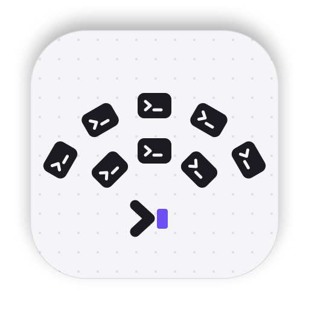

<p align="center">
  
</p>

<h1 align="center">Bashestra</h1>

<p align="center">
  <b>Conduct your orchestra of coding agents.</b><br>
  An app for macOS and Linux that runs Claude Code, Codex, Gemini CLI and OpenCode side by side on an infinite canvas.<br>
  Every node is a real terminal. Draw a line between two agents and they can message each other.
</p>

<p align="center">
  <a href="https://github.com/federix-ai/draftboard-app/releases/latest/download/Bashestra.dmg"><b>⬇ Download for macOS</b></a>
  &nbsp;·&nbsp;
  <a href="https://github.com/federix-ai/draftboard-app/releases/download/v0.7.0/Bashestra-0.7.0.AppImage"><b>⬇ Linux AppImage</b></a>
  &nbsp;·&nbsp;
  <a href="https://federix-ai.github.io/draftboard-app/">Project page</a>
  &nbsp;·&nbsp;
  <a href="https://github.com/federix-ai/draftboard-app/releases">Releases</a>
</p>

<p align="center">
  
  
  
  
  
</p>

---

## New in 0.9.0

- **Mockups** (<kbd>⌃⌘T</kbd>). The screens your agents publish with `orch tavola`, full screen and in order as in Figma: rows per flow with arrows from the zones, sites at several widths, apps on every device, graphics and PDFs. Double-click for the focus with versions and arrows, <kbd>Space</kbd> to present them as a prototype, <kbd>C</kbd> to comment: the comments go back to the agent that made them.
- **The mockups panel.** On the left of Mockups, every mockup by row: a click brings it into view, dragging moves it between rows, <kbd>⌘F</kbd> finds it. The selected one can be renamed, switched to another version, commented with <kbd>⌃⌘C</kbd>, and shows its captures.
- **Every session's chat.** At the top of the Maestro's chat there's a picker with your sessions: choose one to read its conversation in full, and the ❯ field writes to it. Focus on a session and the panel opens on its tab.
- **Questions in one click.** When an agent ends its turn with questions, a card collects them: pick the answers (keys 1–9 work too) and they go together. The session moves to *Needs you*, and the chat shows tables, lists and headings instead of raw text.
- **Mockups that stay.** “Save the mockups in the project” writes the latest version of each to `design/tavole`, with a README, so they go in git. A deleted floor hands its mockups to P0.

> 0.9.0 is on the Mac. Linux stays on 0.7.0 for now.

## New in 0.8.0

- **Bashestra in your phone's browser** (Mac). Open Bashestra from your phone as you would at the Mac: the sessions with what waits for you on top, the output, the whole plan to approve, the real terminal with the keys iOS lacks, the Maestro's chat to start new work. It goes on the Home Screen and every browser pairs with a code. Free, through your own Tailscale: nothing goes on the internet. [Set it up in five steps ↓](#bashestra-on-your-phone)
- **On your phone with Telegram** (Mac). When a session waits for you, a Telegram message arrives: approve or deny a permission, read and approve a plan, pick the answer to a question, give the Maestro the go-ahead, confirm a merge or unblock a stopped session. Reply to the message to write to the session; **Open** leads to the phone page.
- **Done, and verified.** When an agent ends its turn, Bashestra runs its folder's checks (build, test, lint) in the worktree and sends a failure back to the agent up to twice, then to you. Sessions touching the same files show on the canvas before merging, and the merge queue in Git rebases and merges them one at a time, with your OK.
- **Output view for Codex and Gemini too.** Claude's plan arrives in a card to approve, and “Always in this workspace” makes a rule for commands you approve often.
- **Budgets and a loop guard.** A token cap per session and per team; the same error or command over and over stops the session, which says why and waits for you. Restore points take a node back to before a turn.
- **Comparisons.** The same task from the same commit three ways (Claude Code alone, the Maestro alone, the Maestro with a team), side by side in Usage › Comparisons.

> Telegram and the phone page are on the Mac. Linux stays on 0.7.0 for now.

## What it does

- **Real terminals on a canvas.** Each node is a full terminal running your agent CLI. The strip's Sessions badge and the capsule in the bar show who needs you; <kbd>⌘J</kbd> jumps to the next one waiting.
- **Linked agents talk.** Drag a line between two nodes. Agents use `orch send <name> "…"` to message a colleague; messages queue until the receiver is free.
- **Teams in one click.** Ready-made teams (Feature squad, Pair, Bug hunt, Parallel build, Exploration, Full squad, Interface and more), already linked, with the task going to the leader: <kbd>⇧⌘T</kbd> or **+ New › Team**. Or build your own and save it.
- **A worktree per agent.** In a git repository every agent works on its own `orch/<name>` branch. The Git section shows the branch graph, diffs, commit, push and branch switching.
- **Floors for experiments.** Copy a workspace and its repositories instantly with APFS clones, try an idea, then bring the branches back or throw it away.
- **Mockups in order.** The screens agents design line up as flows you can present like a prototype and comment on; the comments go back to their author.
- **Point at the bug.** Web and iOS Simulator nodes next to the agents: capture the screen, mark what's wrong and send it to the linked agent.
- **Away from the Mac.** Telegram tells you when a session needs you; the phone page lets you read, answer and start new work, over your own Tailscale.

## Bashestra on your phone

Your Mac serves the page and only your own devices reach it, through a free [Tailscale](https://tailscale.com) account. Nothing goes on the internet and nothing passes through us. About five minutes, once.

1. **Install Tailscale on both.** On the Mac and on the iPhone, from [tailscale.com/download](https://tailscale.com/download) or the App Store. Sign in with the same account on both: the personal plan is free.
2. **Turn it on in Bashestra.** In **Settings › Notifications › In the phone's browser**, switch on **Open Bashestra from the phone**. Bashestra finds Tailscale and tells you what's missing, if anything.
3. **Turn on HTTPS certificates.** If it says HTTPS is off, click **Open the console**: on the DNS page turn on **HTTPS Certificates** (MagicDNS stays on), then **Retry**. *Ready* shows the address, `your-mac.<tailnet>.ts.net`, and a QR code.
4. **Pair the phone.** Scan the QR with the iPhone's camera and open the page in Safari. On the Mac click **Pair a phone** and type the 6-digit code into the page within 10 minutes.
5. **Put it on the Home Screen.** In Safari: **Share › Add to Home Screen**. Open it from the icon and pair once more: the icon and Safari keep separate cookies, so each one pairs once.

| If Bashestra says… | Do this |
|---|---|
| Tailscale is not installed | Install it on the Mac and the phone (**Download Tailscale** opens the page). It's free for personal use. |
| Tailscale is not connected | Open Tailscale on the Mac and sign in with your account, then **Retry**. |
| HTTPS is off in your Tailscale network | Console › DNS: turn on **HTTPS Certificates**, then **Retry**. The very first visit can take a few seconds while the certificate is made. |
| Funnel is on for this Mac | Funnel would put the page on the internet, so Bashestra won't start it. Turn Funnel off and **Retry**. |
| Port 443 of serve is already in use | Another program uses `tailscale serve` on this Mac and Bashestra won't take it over. Free it, then **Retry**. |
| The page asks for a code again | That browser isn't paired yet: the Home Screen icon, Safari and Telegram's own browser each pair once. |

- Bashestra listens only inside the Mac (127.0.0.1); the phone reaches it through `tailscale serve`, encrypted, and only from your own devices. Every browser pairs with a code and the Mac keeps only a hash of its secret: revoke one, or all, from the same settings.
- From the phone you never approve “Always”, and each button decides only the request it shows.
- Bashestra must be open and the Mac awake: with the lid closed, the Mac sleeps.
- **Using Telegram too?** Set it up in **Settings › Notifications › On your phone** with a bot you create with [@BotFather](https://t.me/BotFather). Its messages get an **Open** button that leads to the page: have Telegram open links in Safari, so you're already paired.

## Install

### macOS

1. [Download **Bashestra.dmg**](https://github.com/federix-ai/draftboard-app/releases/latest/download/Bashestra.dmg), open it and drag Bashestra into Applications.
2. Open Bashestra. macOS says it can't verify the developer: click **Done**.
3. Go to **System Settings › Privacy & Security** and click **Open Anyway** next to Bashestra.

> The app is not notarized by Apple yet, so macOS asks you to allow it once.

### Linux

| | x64 | ARM |
|---|---|---|
| **AppImage** (updates itself) | [Bashestra-0.7.0.AppImage](https://github.com/federix-ai/draftboard-app/releases/download/v0.7.0/Bashestra-0.7.0.AppImage) | [Bashestra-0.7.0-arm64.AppImage](https://github.com/federix-ai/draftboard-app/releases/download/v0.7.0/Bashestra-0.7.0-arm64.AppImage) |
| **.deb** (Debian, Ubuntu) | [bashestra-desktop_0.7.0_amd64.deb](https://github.com/federix-ai/draftboard-app/releases/download/v0.7.0/bashestra-desktop_0.7.0_amd64.deb) | [bashestra-desktop_0.7.0_arm64.deb](https://github.com/federix-ai/draftboard-app/releases/download/v0.7.0/bashestra-desktop_0.7.0_arm64.deb) |

```sh
chmod +x Bashestra-*.AppImage && ./Bashestra-*.AppImage   # AppImage
sudo apt install ./bashestra-desktop_*.deb                # or the .deb
```

> Linux is on 0.7.0: Telegram and the phone page are on the Mac for now. On Ubuntu 22.04 and later the AppImage needs FUSE 2: `sudo apt install libfuse2t64` (`libfuse2` on 22.04). The iOS Simulator node exists only on the Mac.

### Requirements

| | |
|---|---|
| **System** | macOS 14 or later on Apple Silicon, or Linux with a desktop on x64 or ARM. English and Italian. |
| **On the phone** | Tailscale on the Mac and the phone (free) for the phone page; a Telegram bot for the messages. Mac only. |
| **Agents** | At least one CLI installed, signed in and on your `PATH`: `claude`, `codex`, `gemini` or `opencode`. |
| **Git** | For worktrees and the Git panel (on the Mac it comes with the Command Line Tools). |

Bashestra runs your CLIs with your own logins: no Bashestra account needed.

## Feedback

Found a problem? [Open an issue](https://github.com/federix-ai/draftboard-app/issues).

<sub>This repository hosts the downloads and the project page. The source code is private.</sub>
