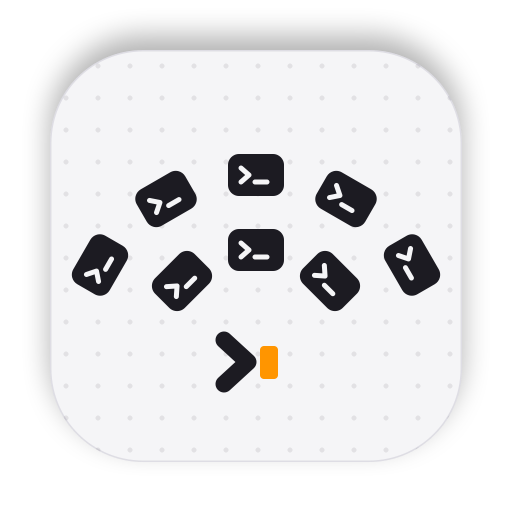

  

<h1 align="center">Bashestra</h1>

  <b>Conduct your orchestra of coding agents.</b> 
  A macOS app that runs Claude Code, Codex, Gemini CLI and OpenCode side by side on an infinite canvas. 
  Every node is a real terminal. Draw a line between two agents and they can message each other.

  <a href="https://github.com/federix-ai/draftboard-app/releases/latest/download/Bashestra.dmg"><b>⬇ Download for macOS</b></a>
  &nbsp;·&nbsp;
  <a href="https://federix-ai.github.io/draftboard-app/">Project page</a>
  &nbsp;·&nbsp;
  <a href="https://github.com/federix-ai/draftboard-app/releases">Releases</a>

  
  
  
  

---

## What it does

- **Real terminals on a canvas.** Each node is a full terminal running your agent CLI. A sidebar shows who needs you, who is working and who is idle; <kbd>⌘J</kbd> jumps to the next one waiting.
- **Linked agents talk.** Drag a line between two nodes. Agents use `orch send <name> "…"` to message a colleague; messages queue until the receiver is free.
- **Teams in one click.** Six ready-made teams (Feature squad, Pair, Bug hunt, Parallel build, Exploration, Full squad), already linked, with the task going to the leader. Or build your own and save it.
- **A worktree per agent.** In a git repository every agent works on its own `orch/<name>` branch. The Git panel shows the branch graph, diffs, commit, push and branch switching.
- **Floors for experiments.** Copy a workspace and its repositories instantly with APFS clones, try an idea, then bring the branches back or throw it away.
- **Point at the bug.** Web and iOS Simulator nodes next to the agents: capture the screen, mark what's wrong and send it to the linked agent.

## Install

1. [Download **Bashestra.dmg**](https://github.com/federix-ai/draftboard-app/releases/latest/download/Bashestra.dmg), open it and drag Bashestra into Applications.
2. Open Bashestra. macOS says it can't verify the developer: click **Done**.
3. Go to **System Settings › Privacy & Security** and click **Open Anyway** next to Bashestra.

> The app is not notarized by Apple yet, so macOS asks you to allow it once.

### Requirements

| | |
|---|---|
| **System** | macOS 14 or later, Apple Silicon. English and Italian. |
| **Agents** | At least one CLI installed and signed in in your terminal: `claude`, `codex`, `gemini` or `opencode`. |
| **Git** | Command Line Tools, for worktrees and the Git panel. |

Bashestra runs your CLIs with your own logins: no Bashestra account needed.

## Feedback

Found a problem? [Open an issue](https://github.com/federix-ai/draftboard-app/issues).

This repository hosts the downloads and the project page. The source code is private.
